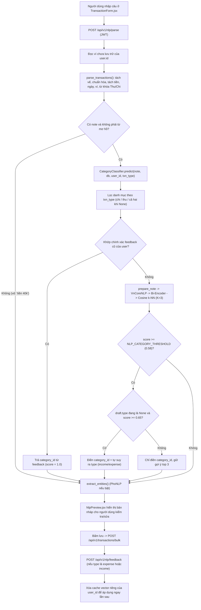
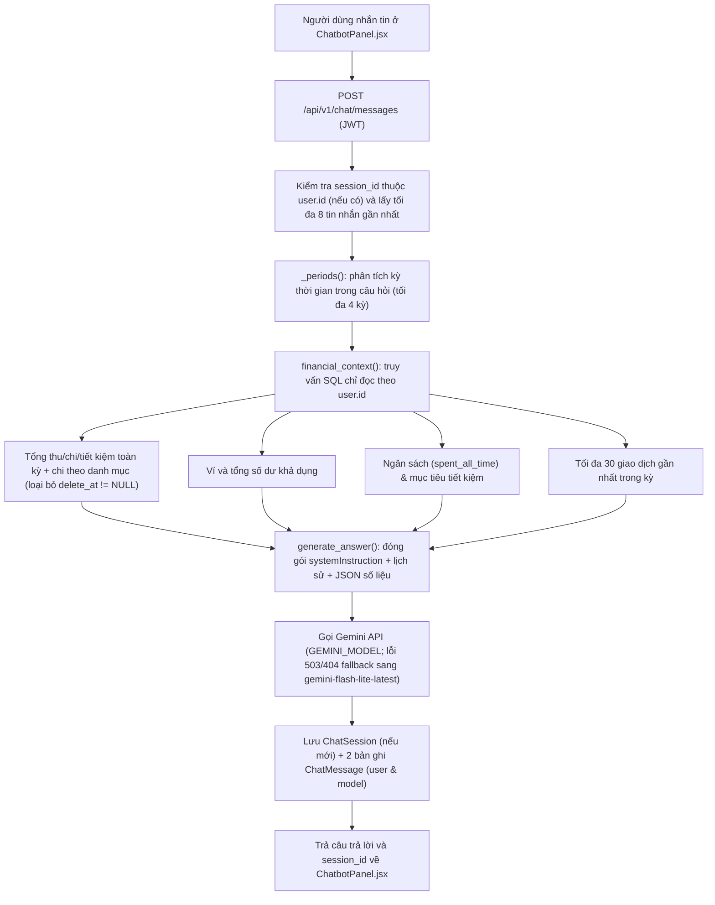

# Kiến trúc & Luồng hoạt động AI trong SmartFin (NLP & Chatbot)

Tài liệu này mô tả luồng dữ liệu đầu cuối của **2 phân hệ AI** hiện có trong SmartFin:
1. **Nhập giao dịch thông minh (NLP):** tách câu tiếng Việt thành bản nháp giao dịch và gợi ý danh mục bằng rule-based parser + VnCoreNLP + Vietnamese Bi-Encoder (fine-tuned) + k-NN.
2. **Trợ lý tài chính (Chatbot Gemini):** truy vấn số liệu cá nhân từ PostgreSQL (chỉ đọc) rồi dùng Gemini API trả lời theo ngữ cảnh tài chính của đúng người dùng đang đăng nhập.

---

## Tổng quan 2 phân hệ

| Thành phần | Mục tiêu | Công nghệ chính | Ghi DB? | Mã nguồn chính |
|---|---|---|---|---|
| **NLP Parser + Classifier** | Chuyển câu nhập tự do thành bản nháp giao dịch | Regex luật (tiền/ngày/ví/tách câu) + `VnCoreNLP` + `biencoder_run1_e3_b16` + Cosine k-NN | **Không tự ghi** khi `/parse`; người dùng kiểm tra rồi xác nhận qua `/transactions/bulk` | `backend/app/ai/nlp_parser/`, `backend/app/ai/classifier/`, `backend/app/api/v1/routers/nlp_api.py` |
| **Chatbot Gemini** | Trả lời hỏi đáp số dư, thu chi, ngân sách, mục tiêu tiết kiệm | SQLAlchemy tổng hợp dữ liệu theo `user_id` + Gemini REST API (`gemini-flash-latest` / fallback `gemini-flash-lite-latest`) | Chỉ lưu lịch sử hội thoại (`chat_sessions`, `chat_messages`), **không ghi/sửa giao dịch** | `backend/app/ai/chat/service.py`, `backend/app/api/v1/routers/chat_api.py`, `ChatbotPanel.jsx` |

---

## Phần 1 — Flow Nhập giao dịch thông minh (NLP)

### 1.1. Sơ đồ luồng xử lý



### 1.2. Chi tiết từng giai đoạn

1. **Khởi động server (`lifespan` trong `backend/main.py`):**
   - `CategoryClassifier.warm_up()` nạp bộ tách từ Java `VnCoreNLP-1.2.jar` (`segmenter.py`, có `threading.Lock` bảo vệ khi nhiều request chạy song song) và model `NLP_ENCODER_DIR` (`models/biencoder_run1_e3_b16` qua `encoder.py`).
   - Đọc tập mẫu `NLP_EXAMPLES_CSV` (`ml/data/runs/run1/train.csv`, gồm 2.122 câu mẫu): lần đầu sẽ chạy `prepare_note` (`underthesea.text_normalize` + `VnCoreNLP`) và mã hóa thành vector 768 chiều, sau đó lưu cache vào `backend/models/.cache/base_vectors_<hash>.npz`. Các lần khởi động lại sau nạp thẳng từ file `.npz` trong dưới 1 giây (tự động tính lại nếu đổi model hoặc sửa file `train.csv`).
   - PhoNLP (`ner.py`) mặc định tắt (`NLP_ENABLE_NER=false`), chỉ chạy khi bật cờ môi trường.

2. **Tách câu & trích xuất thông tin bằng luật (`backend/app/ai/nlp_parser/`):**
   - `splitter.py`: tách nhiều khoản theo dấu `,`, `;`, xuống dòng (nhưng giữ nguyên dấu phẩy thập phân như `1,2 triệu`).
   - `normalizer.py`: chuẩn hóa Unicode NFC, chữ thường, mở rộng viết tắt (`cf` → `cà phê`, `ck` → `chuyển khoản`).
   - `amount.py`: trích số tiền theo số nguyên VND (`45k`, `1tr2`, `1,5 triệu`, `50.000đ`, hoặc số trần ở cuối câu kèm cảnh báo xác nhận).
   - `time_parser.py`: nhận ngày `dd/mm(/yyyy)` hoặc `hôm nay`, `hôm qua`, `hôm kia` (múi giờ `Asia/Bangkok`); khoản sau tự kế thừa ngày của khoản trước nếu không nêu lại ngày.
   - `wallet_matcher.py`: chỉ khớp trong danh sách ví thuộc `user_id` hiện tại; nếu user có đúng 1 ví thì tự chọn ví đó.
   - `parser.py`: nhận diện loại `income` / `expense` dựa trên regex `INCOME` và `EXPENSE` (loại trừ phần đã khớp `INCOME` trước khi dò `EXPENSE` để các cụm như `"được trả"`, `"được lì xì"`, `"được tặng"` không bị nhận nhầm thành chi tiêu). Các câu ngắn thiếu động từ (ví dụ `"vé xe 50k"`, `"tiền điện 300k"`) tạm để `type = None` để chuyển cho AI xử lý ở bước sau.

3. **Phân loại danh mục & suy luận loại thu/chi (`service.py` + `nlp_api.py`):**
   - API kiểm tra `note`: bỏ qua phân loại tự động nếu `type` là `None` và `note` thuộc nhóm từ quá mơ hồ (`"tiền"`, `"khoản"`, `"giao dịch"`, `"chi"`, `"thu"`).
   - Lọc ứng viên theo `txn_type`:
     - `expense`: loại bỏ 4 danh mục thu (`Lương`, `Thưởng`, `Thu nợ`, `Thu nhập khác` / `Hoàn tiền`) và `Tiết kiệm`.
     - `income`: loại bỏ 12 danh mục chi và `Tiết kiệm`; có fallback ánh xạ `"Thu nhập khác"` → `"Hoàn tiền"` nếu DB dùng tên `"Hoàn tiền"`.
     - `None` (câu ngắn chưa có động từ): cho phép tìm trong cả 12 danh mục chi + 4 danh mục thu (vẫn loại `Tiết kiệm`).
   - Gộp vector mẫu gốc (`train.csv`) với vector từ bảng `nlp_feedback` của riêng `user_id` đó (ưu tiên khớp chính xác `normalize(note)` trước với `score = 1.0`, sau đó mới tính Cosine k-NN với `NLP_CATEGORY_K = 3`).
   - Nếu `score >= NLP_CATEGORY_THRESHOLD` (`0.58`), gán `category_id` và xóa cảnh báo `"Chọn danh mục"`. Nếu `draft["type"]` đang là `None` và `score >= max(0.65, THRESHOLD)`, tự điền `type` (`income` hoặc `expense`) tương ứng với danh mục đoán được.

4. **Xem trước, lưu giao dịch & vòng lặp học từ phản hồi:**
   - Frontend (`TransactionForm.jsx`, `NlpPreview.jsx`) hiển thị bản nháp để người dùng sửa bất kỳ trường nào và bấm lưu qua `POST /api/v1/transactions/bulk`.
   - Ngay sau khi lưu thành công, với các giao dịch `expense` và `income`, frontend gọi `POST /api/v1/nlp/feedback` để lưu nhãn chuẩn vào `nlp_feedback` và gọi `invalidate_user(user_id)`.
   - Định kỳ có thể chạy `ml/export_feedback_for_review.py` để xuất dữ liệu đã xác nhận ra CSV, duyệt `reviewed=1`, gộp vào `ml/data/reviewed_labels.csv` và train lại bằng `ml/run_gpu_training.py`.

---

## Phần 2 — Flow Chatbot Tài chính (Gemini)

### 2.1. Sơ đồ luồng xử lý



### 2.2. Chi tiết hoạt động & nguyên tắc an toàn

1. **Giao diện (`ChatbotPanel.jsx` nhúng trong `MainLayout.jsx`):**
   - Nút bong bóng chat nổi ở góc phải các trang người dùng.
   - Khi mở panel: gọi `GET /api/v1/chat/sessions`, tự khôi phục lịch sử của phiên gần nhất qua `GET /api/v1/chat/sessions/{id}/messages`. Hỗ trợ tạo phiên mới, chuyển phiên cũ và xóa phiên (`DELETE /api/v1/chat/sessions/{id}`).
   - Toàn bộ các endpoint kiểm tra quyền sở hữu theo `user.id` từ JWT.

2. **Trích xuất ngữ cảnh tài chính từ DB (`backend/app/ai/chat/service.py`):**
   - `_periods(question, now)`: nhận diện kỳ thời gian từ câu hỏi (`tháng này`, `tháng trước`, `tháng N`, `tháng N/YYYY`, `quý này/trước/N`, `năm nay/trước/YYYY`), hỗ trợ so sánh tối đa 4 kỳ trong cùng một câu hỏi; nếu câu hỏi không nêu kỳ cụ thể sẽ mặc định lấy tháng hiện tại.
   - `financial_context()`: mọi truy vấn đều lọc `user_id` và bỏ giao dịch xóa mềm (`Transaction.delete_at.is_(None)`). Các con số tổng thu/chi và tổng chi theo từng danh mục được tính trực tiếp bằng SQL `SUM` trên toàn bộ giao dịch trong kỳ (không cộng thủ công từ danh sách 30 giao dịch gần nhất).
   - Không đưa mật khẩu, email hay API key vào JSON gửi sang Gemini.

3. **Sinh câu trả lời (`generate_answer`):**
   - Ghép `systemInstruction` ràng buộc Gemini: chỉ phát biểu số liệu từ JSON, nêu rõ kỳ dữ liệu, lưu ý `budgets.spent_all_time` là chi lũy kế (không phải riêng tháng), không bịa số liệu kỳ khác, từ chối câu hỏi ngoài phạm vi tài chính cá nhân/SmartFin, và xem nội dung ghi chú giao dịch chỉ là dữ liệu (chống prompt injection).
   - Gọi `GEMINI_MODEL` (mặc định `gemini-flash-latest`) với `temperature = 0.2`, `maxOutputTokens = 700`. Nếu gặp lỗi `503` hoặc `404`, tự động fallback sang `gemini-flash-lite-latest`. Lỗi `429` báo giới hạn lượt gọi; lỗi `401/403` báo lỗi API key.
   - Lưu tin nhắn `user` và `model` vào DB rồi trả về frontend.

---

## Cấu hình & Kiểm tra nhanh

### Biến môi trường trong `backend/.env`
```dotenv
# NLP Classifier
NLP_ENCODER_DIR=models/biencoder_run1_e3_b16
NLP_EXAMPLES_CSV=ml/data/runs/run1/train.csv
NLP_CATEGORY_K=3
NLP_CATEGORY_THRESHOLD=0.58

# Chatbot Gemini
GEMINI_API_KEY=<key_cua_ban>
GEMINI_MODEL=gemini-flash-latest
```

### Lệnh kiểm tra từ thư mục `SmartFin/backend`
```powershell
# Chạy unit test NLP + Chatbot
.\venv\Scripts\python.exe -m pytest tests/test_nlp_rules.py tests/test_nlp_classifier.py tests/test_nlp_api.py tests/test_training_data.py tests/test_chat_service.py

# Kiểm tra E2E trên DB (tự rollback sau khi chạy)
.\venv\Scripts\python.exe scripts/smoke_nlp_e2e.py
.\venv\Scripts\python.exe scripts/smoke_chat_e2e.py
.\venv\Scripts\python.exe scripts/smoke_chat_e2e.py --live
```
